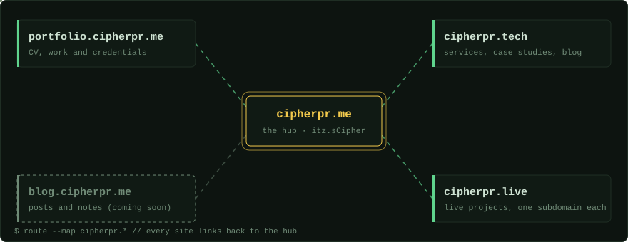

<div align="center">



[**cipherpr.me**](https://cipherpr.me) · [**portfolio**](https://portfolio.cipherpr.me) · [**cipherpr.tech**](https://cipherpr.tech) · [**cipherpr.live**](https://cipherpr.live) · [**X**](https://x.com/itz_sCipher)

</div>

## `// CIPHER SHELL`

```text
$ cat mission.txt
turn ideas into useful, deployed digital systems.

$ cat stack.txt
React · Next.js · Three.js / R3F · Node · Express · Socket.IO
MongoDB · Supabase · Flutter · Cloudflare · Vercel · Netlify · Git

$ echo $STATUS
building depth into the web
```

## `// COMMAND CENTER`

| Build | What it is | Stack | Link |
|---|---|---|---|
| **LASU Connect** | Real-time campus platform for LASU students: chat, events, channels | Node · Express · Socket.IO · MongoDB | [live](https://lasu-connect.netlify.app/) · [repo](https://github.com/lord-saviord1/lasu-connect) |
| **TAG IT ON** | 3D product experience | Next.js · React Three Fiber · Three.js | [live](https://tagiton.cipherpr.live) |
| **Jochebed's Touch** | Custom WebGL site with shaders and smooth scrolling | JavaScript · WebGL | [live](https://jochebedstouch.cipherpr.live) |
| **PENOVA** | Depth-led service platform | Next.js · Tailwind | [live](https://penova-eight.vercel.app) |
| **Full Midnight Shutdown** | Event site with ticket checkout and live ticket counts | HTML · JS · Supabase · Paystack | [live](https://fullmidnightshutdown.cipherpr.live) |
| **CipherStream** | IPTV aggregator: Flutter app with a Node backend | Flutter · Node · Express | [app repo](https://github.com/lord-saviord1/cipherstream-flutter) · [backend](https://github.com/lord-saviord1/cipherstream-backend) |
| **Cipher::Audit** | SEO console that uses the Claude API | JavaScript | [repo](https://github.com/lord-saviord1/cipher-audit) |

## `// DOMAIN NETWORK`

<div align="center">



</div>

| Domain | Role |
|---|---|
| [cipherpr.me](https://cipherpr.me) | The hub. Everything starts here. |
| [portfolio.cipherpr.me](https://portfolio.cipherpr.me) | The formal record: CV, work, credentials. |
| [cipherpr.tech](https://cipherpr.tech) | Cipher PR: services, case studies, blog. |
| [cipherpr.live](https://cipherpr.live) | Live projects, one subdomain each. |

## `// GITHUB TELEMETRY`

<div align="center">



</div>

<details>
<summary>Full telemetry tables (services, providers, per-project data)</summary>

<!-- TELEMETRY:START -->
_This block is generated by `telemetry/generate-telemetry.js`. Run the "Update repository telemetry" workflow once to fill it._
<!-- TELEMETRY:END -->

</details>

## `// CONNECT`

[GitHub org · Cipher-PR](https://github.com/Cipher-PR) · [X · @itz_sCipher](https://x.com/itz_sCipher) · [LinkedIn](https://www.linkedin.com/in/cipherpr) · [Instagram · itz.scipherpr](https://www.instagram.com/itz.scipherpr)

```text
STATUS: BUILDING DEPTH INTO THE WEB.
```
